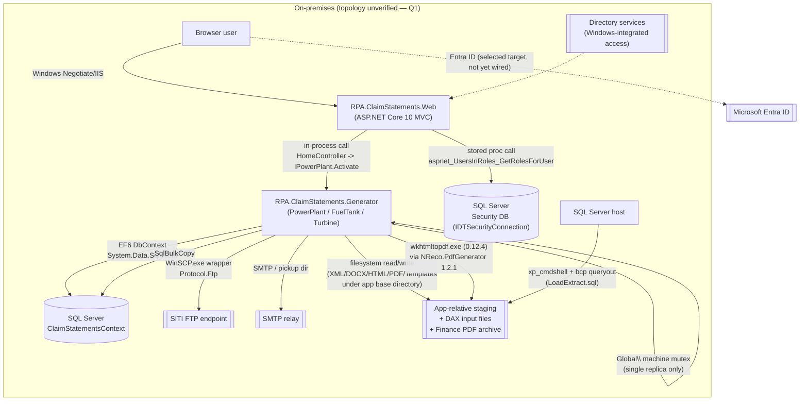
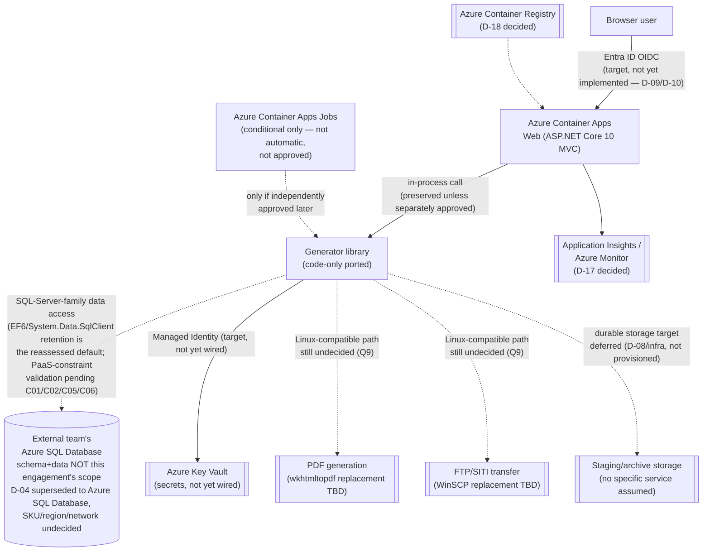

# Application Assessment Report

**Generated:** 2026-10-16
**Application:** RPA Claim Statements (Claim Statement Generator / CSG) — DEFRA
**Source Path:** `RPA.ClaimStatements\` (sln: `RPA.ClaimStatements\RPA.ClaimStatements.sln`), plus `PdfCompare\` (dev-only tool) and `DAXAPFileTransfer.ps1`
**Assessment Type:** Phase 1 — Planning & Assessment (**code-only modernization scope**)
**Status:** Draft for code-only execution; external contract/native-dependency choices required — **not** an Architect-approved production architecture

> **Scope note:** Target **Azure SQL Database** schema and data are owned and supplied by an external team (database
> engine superseded 2026-10-16, same day, from an earlier Azure PostgreSQL selection — see
> `reports/Decisions-Required.md` D-04 and `reports/Decision-Log.md`; the user's own words: *"It will be Azure SQL
> Database, not postgresql."*). This assessment and the accompanying `Migration-Plan.md` cover **application code
> changes only** — no schema provisioning, schema/data conversion, or data movement is in scope here. Region,
> budget, DR (RPO/RTO), cutover strategy, and acceptable downtime (D-08, D-12, D-13, D-14, D-15) are **explicitly
> deferred**, not resolved, and remain pending before Phase 3/4 (infra/deploy) work. Decision reconciliation
> (`reports/Decisions-Required.md`, `reports/Decision-Log.md`) is owned by another workstream and is not modified by
> this report. **Earlier PostgreSQL-specific findings in this report's prior revision are superseded by this
> revision's Azure SQL Database analysis below** — the engine-family change (SQL Server → Azure SQL Database, not
> SQL Server → PostgreSQL) means several PostgreSQL-only risks no longer apply, while new, narrower Azure SQL
> Database PaaS-specific validation items replace them (see § Azure SQL Database Compatibility Blast Radius).

## Executive Summary

- **Current platform:** On-premises (confirmed source-code access only; production topology unverified — Q1). ASP.NET Core 10 MVC web app (`RPA.ClaimStatements.Web`) that invokes a console-capable generation engine (`RPA.ClaimStatements.Generator`) **in-process**, against SQL Server (EF6) plus a separate SQL-Server-backed "Security" role database, WinSCP/FTP, SMTP, and filesystem staging/archiving.
- **Recommended target platform (per Capability Matrix, conditional):** Azure Container Apps, with Container Apps Jobs only if an independently packaged batch path is explicitly approved — **not** an automatic decomposition. Azure VMs remain a Windows-compatible fallback if native dependencies cannot be ported (`reports/Capability-Matrix.yaml#migration_strategy.target_azure_candidates`).
- **Primary migration drivers:** User-selected modernization priority; runtime already on .NET 10 (no forced upgrade); user-selected target engine is **Azure SQL Database** (same SQL Server engine family as the current source — superseded 2026-10-16 from an earlier same-day PostgreSQL selection) with externally supplied schema/data; several Windows-native dependencies and a single-replica concurrency model currently block "as-is" Linux/Container Apps compatibility.
- **Top 3 risks:**
  1. **EF6 + `System.Data.SqlClient` + `SqlBulkCopy` + code-based EF6 migrations are SQL-Server-coupled, but that is no longer a cross-engine blocker.** Because the target is now Azure SQL Database (same engine family as the current SQL Server source), **retaining** EF6/`System.Data.SqlClient`/`SqlBulkCopy`/T-SQL is the reassessed default — not an automatic ORM/provider rewrite. The remaining risk is narrower: specific Azure SQL Database **PaaS constraints** (no `xp_cmdshell`, no cross-database queries, no SQL Server Agent, no Windows-integrated authentication) that ordinary SQL Server code may rely on and that must each be explicitly validated against this codebase (see Backlog C01–C04, revised).
  2. **Windows-only native dependencies** (`System.Drawing.Common`, `WinSCP.exe`-wrapped FTP, `wkhtmltopdf.exe` 0.12.4 via `NReco.PdfGenerator` 1.2.1) block Linux-based Container Apps "as-is" and require a validated, PDF-parity-preserving replacement path (Q9, pending). **Unaffected by the database-engine supersession.**
  3. **Low evidence confidence across data, network, operational, and compliance axes** (`reports/Capability-Matrix.yaml#risk_flags: low-evidence-confidence`) means several of the above risks cannot be fully bounded until the external Azure SQL Database contract, production topology, and identity/role-mapping facts are confirmed (see `.github/skills/risk-low-evidence-confidence.md`).
- **Baseline build status (code-only, no remediation attempted by this report):** see [§ Baseline Build Evidence](#baseline-build-evidence) below — build currently blocked by a package-feed/policy rejection, not a C# compile error.

## Migration Configuration

| Setting | Value | Source |
|---|---|---|
| Modernization scope | Code-only (schema/data owned externally) | User confirmation 2026-10-16; `Capability-Matrix.yaml#planning_inputs.delivery_scope` |
| Target Azure hosting platform | Azure Container Apps (Jobs only if demonstrably necessary) | D-06 ✅ DECIDED; `Capability-Matrix.yaml#compatibility.requested_target` |
| IaC tool | Pending (D-07 ⏸ PENDING — selection captured, scope unconfirmed) | `Decisions-Required.md` Decision 7 |
| Database engine (target) | **Azure SQL Database** (engine choice only; exact SKU/service owned by external team, not confirmed here; superseded 2026-10-16 from an earlier same-day Azure PostgreSQL selection) | D-04 ✅ DECIDED (superseded); `Capability-Matrix.yaml#planning_inputs.target_database_preference` |
| Database migration scope | No DB migration by this agent; schema/data externally supplied — provisioning/conversion/movement out of scope | D-05 🚫 N/A — current code-only scope (clarified); user confirmation 2026-10-16 |
| Authentication target | Microsoft Entra ID, single-tenant | D-09, D-10 ✅ DECIDED |
| Compliance scope | GDPR / UK-GDPR (exact obligations unverified — Q4) | D-11 ✅ DECIDED |
| CI/CD | Keep current CI/CD (provider/configuration unspecified) | D-16 ✅ DECIDED |
| Observability | Azure Monitor + Application Insights | D-17 ✅ DECIDED |
| Container registry | Azure Container Registry | D-18 ✅ DECIDED |
| IaC / Region / budget / DR / cutover / downtime | Explicitly deferred, not a gate waiver (D-07, D-08, D-12, D-13, D-14, D-15 ⏸ PENDING) | `Decisions-Required.md` Status summary (10 DECIDED / 2 N/A / 6 PENDING, reconciled) |

## Current Architecture

## Target Azure Architecture

> **Conceptual target only — not an approved deployment architecture.** This diagram reuses the same conditional
> target state already recorded in `reports/Migration-Plan.md` § 3 (Target Azure Architecture) and reflects only the
> decisions actually ✅ DECIDED in `reports/Decisions-Required.md` (D-04 engine, D-06 hosting, D-09/D-10 identity,
> D-11 compliance, D-16/D-17/D-18 CI/CD/observability/registry). Region, network topology, SKU, replica count, and
> durable-storage target are **unknown/deferred** (D-07, D-08, D-12, D-13, D-14, D-15 ⏸ PENDING) and are **not**
> invented here. The in-process call pattern (Web → Generator) is preserved as-is, since no separate worker
> decomposition has been approved — Container Apps Jobs appear only as a conditional, not-yet-approved option. The
> target **Azure SQL Database** schema and data remain owned and supplied by an external team; no schema/data work
> is depicted or implied. **D-04's engine selection was superseded 2026-10-16, same day, from an earlier Azure
> PostgreSQL selection — the diagram below reflects the current, authoritative Azure SQL Database target.**

Dashed arrows mark paths with an unresolved decision or external dependency; solid arrows mark the only parts of
this target state that are both ✅ DECIDED and already reflected in source today (hosting platform choice and the
preserved in-process call shape). No Front Door, Redis, specific region, or SKU is shown — none has been approved.

## Application Inventory

### Projects and runtimes

| Project | Output type | Target framework | Role | Evidence |
|---|---|---|---|---|
| `RPA.ClaimStatements.Generator` | Exe (console) | `net10.0` | Console generator + shared in-process generation logic (also referenced by Web) | `RPA.ClaimStatements\RPA.ClaimStatements.Generator\RPA.ClaimStatements.Generator.csproj` |
| `RPA.ClaimStatements.Web` | Web (ASP.NET Core MVC) | `net10.0` | Administrative UI; references Generator; invokes generation in-process | `RPA.ClaimStatements\RPA.ClaimStatements.Web\RPA.ClaimStatements.Web.csproj`, `Controllers\HomeController.cs:16-43` |
| `RPA.ClaimStatements.Generator.Tests` | Test (NUnit) | `net10.0` | Unit tests for Generator | `RPA.ClaimStatements\RPA.ClaimStatements.Generator.Tests\RPA.ClaimStatements.Generator.Tests.csproj` |
| `RPA.ClaimStatements.Web.Tests` | Test (NUnit) | `net10.0` | Unit tests for Web | `RPA.ClaimStatements\RPA.ClaimStatements.Web.Tests\RPA.ClaimStatements.Web.Tests.csproj` |
| `PdfCompare` (Node.js) | Dev/test tooling, not production | n/a (Node version unknown — Q12) | Manually invoked PDF text-comparison utility | `PdfCompare\package.json` |

All four `.csproj` files already target `net10.0` — **no runtime upgrade is required or proposed**; `reports/Capability-Matrix.yaml#stack` records this at `high` evidence confidence, and the historical `.NET Framework 4.5` references in `modernization-findings.md` describe a prior, already-completed upgrade pass, not the current state.

### Dependency inventory (compiled packages only, from `.csproj` `PackageReference`s — excludes files the project explicitly removes from compilation)

**`RPA.ClaimStatements.Generator.csproj`:**

| Package | Version | Role | Notes |
|---|---|---|---|
| CsvHelper | 2.16.3 | CSV parsing | Old version; flagged in `modernization-findings.md` item 6 |
| DocumentFormat.OpenXml | 2.7.2 | DOCX template manipulation | Old version; flagged in `modernization-findings.md` item 6 |
| EntityFramework | 6.5.2 | ORM (SQL Server, `DbContext`/`DbMigrator`) | See Backlog C01, C02 |
| EPPlus | 4.5.3.3 | Excel generation | Deprecated; pulls `System.Drawing.Common` transitively (pinned, see below) |
| FastMember | 1.5.0 | Reflection helper for `SqlBulkCopy` (`ObjectReader`) | Used directly by `SQLBulkInsert<T>` |
| Microsoft.VisualStudio.SlowCheetah | 4.0.50 | Build-time config transforms (`App.*.config`) | Build tool only |
| NBuilder | 6.1.0 | Test data builder | |
| NReco.PdfGenerator | 1.2.1 | Wraps `wkhtmltopdf.exe` 0.12.4 for HTML→PDF | Archived upstream project; CVE-2022-35583 (SSRF) per `modernization-findings.md` item 3 |
| OpenXmlPowerTools | 4.5.3.2 | DOCX→HTML/XML transform (compatibility mode) | Old version; flagged in `modernization-findings.md` item 6 |
| System.Configuration.ConfigurationManager | 10.0.12 | Reads `App.config` under .NET 10 | |
| System.Drawing.Common | 10.0.12 | Windows-only GDI+ wrapper (pinned deliberately) | Pin comment in csproj: "without this pin EPPlus 4.5.3.3 resolves System.Drawing.Common 4.7.0 (critical advisory GHSA-rxg9-xrhp-64gj)" |
| Unity | 5.11.10 | DI container | |
| WinSCP | 6.5.7 | Managed wrapper over native `WinSCP.exe` | FTP transport only (`Protocol.Ftp`), not SFTP — see `FTPService.cs` |
| System.Management.Automation.dll | 10.0.10586 | Transitive-only, `ExcludeAssets="all"` | csproj comment: "Only a transitive dependency of OpenXmlPowerTools; nothing in this code uses it." Build-blocking package — see Baseline Build Evidence below |

**`RPA.ClaimStatements.Web.csproj`:**

| Package | Version | Role | Notes |
|---|---|---|---|
| Microsoft.AspNetCore.Authentication.Negotiate | 10.0.13 | Windows Negotiate/Kerberos auth | Must be reconciled with D-09 Entra ID selection (Q3) |
| Microsoft.VisualStudio.SlowCheetah | 4.0.50 | Build-time config transforms | Build tool only |
| System.Data.SqlClient | 4.8.6 | `SqlConnection`/`SqlCommand` for `RoleStore.cs` | Legacy (non-Microsoft.Data.SqlClient) SQL Server client; SQL-Server-specific by name |
| Unity.Microsoft.DependencyInjection | 5.11.5 | Wires Unity container into ASP.NET Core DI | |
| X.PagedList.Mvc.Core | 10.6.0 | Paging UI helper | |

**`RPA.ClaimStatements.Generator.Tests.csproj`** (test-only packages, included for completeness): EntityFrameworkTesting.Moq 1.3.0, Microsoft.NET.Test.Sdk 17.14.1, Moq 4.20.72, NUnit 3.14.0, NUnit3TestAdapter 5.0.0.

**`RPA.ClaimStatements.Web.Tests.csproj`** (test-only packages): Microsoft.NET.Test.Sdk 17.14.1, Moq 4.20.72, NUnit 3.14.0, NUnit3TestAdapter 5.0.0.

**`PdfCompare\package.json`** (Node.js, **dev-only tool, not part of the deployed application runtime**): `pdf-parse` ^1.1.1, `string-hash` ^1.1.3. Node.js runtime version is unknown (Q12).

> **Dependency risk framing:** per the Capability Matrix, the current stack is **already on a supported .NET LTS (`net10.0`)** — this is a dependency *compatibility/portability* risk assessment, not an unsupported-runtime claim. Several individual packages above (EPPlus, OpenXmlPowerTools, CsvHelper, DocumentFormat.OpenXml) are old/deprecated at the *package* level per `modernization-findings.md` item 6, independent of the runtime they run on.

### Compiled-vs-excluded verification (no double counting)

The following files **exist on disk** but are **explicitly excluded from compilation** by `<Compile Remove>` entries in the relevant `.csproj`, confirmed present but inert:

| Excluded path | Verified present | Excluded by |
|---|---|---|
| `RPA.ClaimStatements.Generator\Imports\**` | Yes | `RPA.ClaimStatements.Generator.csproj` |
| `RPA.ClaimStatements.Generator\Services\EmailService.cs` (+ `BuildService.cs`, `IBuildService.cs`, `IEmailService.cs`, `IImportService.cs`, `ILogService.cs`, `ImportService.cs`, `ITransformService.cs`, `IValidationService.cs`, `LogService.cs`, `TransformService.cs`, `ValidationService.cs`) | Yes (`EmailService.cs`, `TransformService.cs` spot-checked) | `RPA.ClaimStatements.Generator.csproj` |
| `RPA.ClaimStatements.Web\Controllers\ARController.cs` | Yes | `RPA.ClaimStatements.Web.csproj` — csproj comment: "ARController was never part of the legacy build; it stays in git, unchanged." |
| `RPA.ClaimStatements.Web.Tests\Controllers\ARControllerTests.cs` | Yes | `RPA.ClaimStatements.Web.Tests.csproj` |
| `RPA.ClaimStatements.Generator.Tests\Services\GenerationServiceTests.cs`, `ImportServiceTests.cs`, `LoadServiceTests.cs`, `LogServiceTests.cs`, `ValidationServiceTests.cs` | Not individually re-opened; csproj comment states "never part of the legacy test build" | `RPA.ClaimStatements.Generator.Tests.csproj` |

The **compiled, active** equivalents live under a different path and were used for evidence in this report: `Components\TrackingStation\EmailService.cs` and `Components\Turbine\TransformService.cs` are the live files registered in `Program.cs`'s Unity container (`container.RegisterType<IEmailService, EmailService>()`, `container.RegisterType<ITransformService, TransformService>()`), distinct from the excluded `Services\EmailService.cs` / `Services\TransformService.cs` duplicates. Per `modernization-findings.md` item 8, `ARController`'s exclusion means **22 actions remain live** elsewhere in `Web`'s compiled controllers — this report does not re-derive that count, only cites it.

### Authentication and authorization

- **Current sign-in:** Windows Negotiate, selected per-request by server type (IIS in-process vs Kestrel), configured in `RPA.ClaimStatements.Web\Program.cs` (`AddPolicyScheme("WindowsOrNegotiate", ...)`, `.AddNegotiate()`). An explicit `<deny users="?" />`-equivalent middleware challenges any unauthenticated request before static files are served (`Program.cs`, the `app.Use(async (context, next) => ...)` block).
- **Role source:** Custom `IRoleStore` → `SecurityDatabaseRoleStore` (`RPA.ClaimStatements.Web\Security\RoleStore.cs`) calls the stored procedure `dbo.aspnet_UsersInRoles_GetRolesForUser` (ASP.NET SQL Server membership schema) against a **separate** SQL Server connection (`IDTSecurityConnection`, confirmed present with `providerName="System.Data.SqlClient"` in both `RPA.ClaimStatements.Generator\App.config:16` pattern and `RPA.ClaimStatements.Web\App.config:21-22` — connection string **values** intentionally omitted from this report).
- **Target:** Microsoft Entra ID, single-tenant (D-09, D-10 ✅ DECIDED). **The code has not yet been changed** — this is a Phase 2 activity. Per `modernization-findings.md` item 13, the Security database's own role-management stored procedures (`aspnet_Roles_CreateRole`) already have known issues against the supplied script ("lost `OUTPUT` parameters"), independent of any PostgreSQL question — this is a **pre-existing SQL Server-side finding**, not a new PostgreSQL-migration finding.
- **Open question (Q3, pending):** sign-in, SSO, user population, delegation, and role-mapping behavior that must be preserved are not yet confirmed with the identity owner.

### Data access and integrations

| Integration | Direction | Protocol | Evidence | Notes |
|---|---|---|---|---|
| SQL Server (application DB) | bidirectional | TDS (EF6 + raw SQL) | `Context\ClaimStatementContext.cs`, `Extensions\EntityFramework.cs`, `Components\PumpingStation\BulkInsert\SQLBulkInsert.cs` | See Backlog C01–C04 |
| SQL Server (Security DB) | inbound (role lookup) | TDS (stored proc call) | `Security\RoleStore.cs` | Separate connection (`IDTSecurityConnection`); SQL-Server-specific stored procedure |
| WinSCP (native exe wrapper) | inbound | managed wrapper + native `WinSCP.exe` | `Components\PumpingStation\FTPService.cs`, `.csproj` `PackageReference Include="WinSCP" Version="6.5.7"` | Not an independent endpoint — transport for the FTP integration below |
| FTP (SITI feed) | inbound | FTP (`Protocol.Ftp`, **not** SFTP) | `FTPService.cs` (`sessionOptions = new SessionOptions { Protocol = Protocol.Ftp, ... }`), `SITIImportService.cs` | No FTPS selection established in source |
| SMTP | outbound | SMTP / pickup-directory | `Components\TrackingStation\EmailService.cs`, `App.config` (both projects) | Network vs. pickup-directory mode is environment-dependent |
| File share | bidirectional | filesystem (UNC/SMB indicated, unverified) | `DAXAPFileTransfer.ps1`, `Services\FolderService.cs` | DAX input files, Finance PDF archive, app-relative staging |
| Active Directory | bidirectional | Windows-integrated | `Web\Program.cs`, `Security\RoleStore.cs` | Superseded in intent by Entra ID selection, not yet implemented |

### Configuration model

- **Runtime config:** `App.config` per project (`RPA.ClaimStatements.Generator\App.config`, `RPA.ClaimStatements.Web\App.config`) with SlowCheetah transforms per build configuration (`App.Debug.config`, `App.Production.config`, `App.Release.config`, `App.SIT.config`, `App.UAT.config`). The Web project pins the Generator's `ConfigurationManager` to its own emitted config file: `AppContext.SetData("APP_CONFIG_FILE", Path.Combine(AppContext.BaseDirectory, "RPA.ClaimStatements.Web.dll.config"))` (`Web\Program.cs`).
- **Connection string names present** (values omitted): `ClaimStatementsContext` (`providerName="System.Data.SqlClient"`) and `IDTSecurityConnection` (`providerName="System.Data.SqlClient"`), confirmed in both `RPA.ClaimStatements.Generator\App.config` and `RPA.ClaimStatements.Web\App.config`.
- **Config-backed folders:** `FolderService.Get(name)` / `GetPath(name)` resolve working folder paths from the `Folders` DbSet (`Context\ClaimStatementContext.cs`), i.e., some path configuration is itself **database-backed**, not purely file-based — relevant to any future externalized-configuration work.
- **DOCX templates** (`ClaimTemplate.docx`, `ClaimTemplateXB.docx`) and `XSLT` (`ClaimXSLT.xslt`, `ClaimXSLTXB.xslt`) exist locally and are referenced by the Web project's content-linking (`Web.csproj` `<Content Include="..\RPA.ClaimStatements.Generator\Templates\ClaimTemplate.docx" .../>`) but are **git-ignored** — per `modernization-findings.md` item 14 and `Capability-Matrix.yaml#compatibility.constraints`, a clean checkout/CI build does **not** have these assets, which blocks reproducible packaging until an approved master source is established (Q8).

## Azure SQL Database Compatibility Blast Radius (direct evidence, code-only; no schema/data work performed)

> **Supersedes this report's earlier "PostgreSQL Conversion Blast Radius" section** (database engine superseded
> 2026-10-16, same day — see `reports/Decisions-Required.md` D-04 and `reports/Decision-Log.md`). This section
> exists specifically to ground D-04/D-05 follow-up and Phase 2 planning in **line-cited, compiled-code evidence**,
> per the current scope clarification that an external team owns the target Azure SQL Database schema and data. No
> live Azure SQL Database connectivity, schema, or compatibility testing was performed — these are **static-evidence
> findings** about what the current SQL-Server-coupled code does, not a verified Azure SQL Database compatibility
> verdict. **Because the target is now the same engine family as the source (SQL Server → Azure SQL Database,
> rather than SQL Server → PostgreSQL), this table's framing has changed:** most rows below conclude "likely
> retainable, subject to validation" rather than "requires an adapter/ORM rewrite." The exceptions are the rows
> describing genuine Azure SQL Database **PaaS constraints** (no accessible host OS, no `xp_cmdshell`, no
> cross-database queries, no Windows-integrated authentication) — those remain explicit, unresolved validation
> items regardless of engine family, because they are PaaS-vs-full-instance differences, not engine-family
> differences.

| # | Evidence (file : line/region) | What it does | Why it matters for an Azure SQL Database target |
|---|---|---|---|
| 1 | `RPA.ClaimStatements.Generator\Context\ClaimStatementContext.cs:1-20` | `ClaimStatementsContext : DbContext` (EntityFramework 6.5.2, `System.Data.Entity`), constructed with `base("ClaimStatementsContext")` naming a classic `App.config` connection string | EF6's SQL Server provider is a Microsoft-supported, actively-functioning provider against Azure SQL Database — **no ORM/provider rewrite is inherently required** by the engine choice alone. Retention is the reassessed default. The connection string itself still needs rewiring from `App.config`/plaintext to Key Vault/managed-identity-based access (see the Authentication bullet below and Backlog C01, revised). |
| 2 | `RPA.ClaimStatements.Generator\Components\PumpingStation\BulkInsert\SQLBulkInsert.cs:1-45` | `SqlBulkCopy` (`System.Data.SqlClient`) driven ingestion, with `FastMember.ObjectReader`, used generically across `Claim`, `SUM`, `SUM2`, `BPS`, `BPSPEN`, `GR`, `GRPEN`, `PR`, `YF`, `CLD`, `XB`, `XBData`, `AP`, `AR` (see `Generator\Program.cs` Unity registrations) | `SqlBulkCopy` **is supported against Azure SQL Database** as a client-side API — this is not an engine-portability blocker the way it was for a PostgreSQL target. The remaining validation is narrower: confirm batch size, timeout, and throughput behavior are acceptable against the external team's actual Azure SQL Database service tier/DTU-vCore allocation (which this report does not know), and confirm the authentication mode used for the bulk-copy connection is compatible with a managed-identity/token-based design (Backlog C02, revised). |
| 3 | `RPA.ClaimStatements.Generator\Components\PowerPlant.cs:88-93` (`RunMigrations()`) and `RPA.ClaimStatements.Generator\Migrations\Configuration.cs` | EF6 **code-based migrations** (`DbMigrationsConfiguration`, `DbMigrator.Update()`) run **at application runtime** on every `Activate()` call, generating T-SQL via EF6's SQL Server migration SQL generator, against a `dbo.__MigrationHistory` table (per `modernization-findings.md` item 10) | EF6's SQL Server migration SQL generator **works unmodified against Azure SQL Database** (same T-SQL dialect) — this is not an engine-portability blocker. The actual risk is unchanged from before and is **architectural, not engine-specific**: this code currently assumes it **owns** the target schema and may alter it at runtime. Against an **externally provisioned** Azure SQL Database schema, runtime-applied migrations must not silently take ownership of (or attempt to alter) a schema that another team provisions and controls — this requires an explicit, documented schema-ownership/migration-execution contract with the external team (e.g., migrations disabled/no-op in this environment, or run only against a schema the external team has explicitly delegated) before any Phase 2 change, not an assumption that migrations can simply keep running (Backlog C03, revised). |
| 4 | `RPA.ClaimStatements.Generator\Context\ClaimStatementContext.cs` `DbSet<T>` names (e.g. `AP`, `AR`, `BPS`, `BPSPEN`, `CLD`, `GR`, `GRPEN`, `PR`, `SUM`, `SUM2`, `XB`, `XBData`, `YF`) | EF6 default table/identifier naming follows SQL Server's case-insensitive collation and bracket-quoting conventions | Azure SQL Database uses the **same T-SQL identifier case-folding/bracket-quoting rules as SQL Server** (it is the same engine family) — the cross-engine identifier-casing collision risk that applied to a PostgreSQL target **does not apply here** and this row is retired as a blocking risk. The external team's schema delivery still needs to match the exact table/column names and types EF6's model expects, but that is an ordinary schema-contract-fidelity question, not a cross-engine casing-translation question (Backlog C05, retired/narrowed). |
| 5 | `RPA.ClaimStatements.Generator\Extensions\EntityFramework.cs:16-25` (`DeleteWhere<T>`) | Builds raw SQL by taking `query.ToString()` (EF6's SQL-Server-syntax LINQ translation) and prefixing `"DELETE [Extent1] " + selectSql.Substring(...)`, executed via `db.Database.ExecuteSqlCommand(deleteSql, parameters)` with `SqlParameter` | The `[Extent1]`-bracket-quoted-alias DELETE syntax and `System.Data.SqlClient.SqlParameter` **are standard T-SQL/SqlClient usage that runs unmodified against Azure SQL Database** — this row is retired as a blocking risk under the current engine choice. No rewrite of `DeleteWhere<T>` is required by the engine change alone (Backlog C06, retired). |
| 6 | `RPA.ClaimStatements.Web\Security\RoleStore.cs:1-52` | `SecurityDatabaseRoleStore.GetRolesForUser` calls stored procedure `dbo.aspnet_UsersInRoles_GetRolesForUser` (`System.Data.SqlClient`, `CommandType.StoredProcedure`) against the separate `IDTSecurityConnection` | This classic ASP.NET SQL Server membership/role-provider schema (stored procedures) **runs unmodified against Azure SQL Database** as a T-SQL feature — the engine-portability concern that applied to a PostgreSQL target is retired. **A separate, still-open question remains and is sharpened, not resolved, by Azure SQL Database:** is `IDTSecurityConnection` a **separate Azure SQL Database instance**, and if so, does the application's data-access layer need **cross-database query** capability to reach it from the primary database's connection context? Azure SQL Database (unlike a full SQL Server instance) does **not** support cross-database queries within a single connection/elastic-query-free configuration — if the current code (or any future consolidation) relies on querying across the two databases in a single connection, that is a genuine Azure SQL Database PaaS constraint requiring explicit validation with the external team (Backlog C07, revised). |
| 7 | `RPA.ClaimStatements.FDMR\LoadExtract.sql:125-127` | `DECLARE @CMD VARCHAR(2000) = 'bcp "' + @SQL + '" queryout "' + @FileName + '"  -T -c -t^| -S D1VMGEN001'` followed by `EXEC xp_cmdshell @CMD` | `xp_cmdshell` + `bcp` invoke OS-level commands **on the database host itself**, hard-coding a specific host name. **This is a genuine, unresolved Azure SQL Database PaaS constraint, not retired by the engine family match:** Azure SQL Database is a PaaS service with **no accessible host OS at all** and does **not** support `xp_cmdshell` in any form (this distinction is specific to Azure SQL **Managed Instance**, which supports a sandboxed `xp_cmdshell` — D-04 explicitly selected Azure SQL **Database**, not Managed Instance, so that sandboxed option is not applicable here). The export must be redesigned as a **client-driven** export process (e.g., an application- or tooling-side process that runs `bcp`/an equivalent client tool **against** the database, not a server-side `xp_cmdshell` invocation **on** the database host) or replaced with an Azure-native export mechanism (e.g., `BCP.exe` run from a client/job host, Azure Data Factory, or an application-level export). **Do not conflate a client-run export tool with the current server-host `xp_cmdshell` pattern — they are architecturally different and the current code does the latter.** This remains an independent architecture/ownership question for the external schema/data team, not a code-portability question resolved by this engine choice (Backlog C08, unchanged in substance, sharpened in detail). |
| 8 | `RPA.ClaimStatements.CrossBorder\Cross_Border_Create_Table_Script.sql` (29 `GO`-batch-separated `CREATE TABLE`/`ALTER` statements, e.g. line 11 `CREATE TABLE [dbo].[claim_statement_data]`) | Standalone T-SQL DDL script, outside the EF6 model entirely | Confirms a second, non-EF-managed SQL Server schema surface exists for cross-border claim data; this T-SQL DDL **runs largely unmodified against Azure SQL Database** (same engine family) — its conversion (if any) is explicitly out of this agent's scope per the external-team ownership confirmation, and is simpler than it would have been for a PostgreSQL target (Backlog C09, informational only, unchanged). |
| 9 | `RPA.ClaimStatements.Web\Program.cs` (Windows Negotiate auth) and `App.config` connection strings (implied `Integrated Security`/trusted-connection patterns common to this codebase's era) | Current authentication to SQL Server relies on Windows-integrated patterns for at least some of its SQL connectivity assumptions, independent of the separate Entra ID sign-in question (D-09/D-10) | **New row, specific to Azure SQL Database (did not apply the same way to a PostgreSQL target):** Azure SQL Database does **not** support Windows-integrated ("Integrated Security=true" trusted-connection) authentication at all — it requires SQL authentication (username/password) or Entra ID/managed-identity token-based authentication. Moving the database **connection** itself to Entra ID/managed-identity token-based access is the approved **design direction**, consistent with D-09/D-10 and this agent's managed-identity guardrails, but it is **not** a simple credential swap — it requires validating that the external team's Azure SQL Database provisioning supports the chosen token-acquisition pattern (e.g., `DefaultAzureCredential`/`Microsoft.Data.SqlClient`'s Azure AD authentication modes) before implementation (new Backlog C20). |

**Net effect:** retaining EF6, `System.Data.SqlClient`, T-SQL syntax, and `SqlBulkCopy` against Azure SQL Database
**is not inherently blocked by the engine change** — unlike the earlier PostgreSQL analysis, no ORM/provider swap or
major rewrite is automatically required, because the current source (SQL Server) and the new target (Azure SQL
Database) share the same engine family and T-SQL dialect. Retention of the existing data-access stack is the
reassessed default. **What remains genuinely open is a smaller, more specific set of Azure SQL Database PaaS
constraints** that do not exist on a full SQL Server instance: (a) the FDMR `xp_cmdshell`/`bcp` database-host export
has no equivalent at all on Azure SQL Database and must be redesigned as a client-driven process (row 7); (b)
cross-database query capability to the separate Security database needs validation if the current code relies on it
(row 6); (c) runtime-applied EF6 migrations must not silently take ownership of an externally-provisioned schema
without an explicit schema-ownership contract (row 3); and (d) Windows-integrated/trusted-connection database
authentication has no Azure SQL Database equivalent and must move to SQL authentication or, preferably, an approved
Entra ID/managed-identity token-based design (row 9). Migrating to EF Core and/or `Microsoft.Data.SqlClient` remains
a **separate, still-optional** modernization decision that this report does **not** mandate — it requires its own
explicit approval and supporting evidence, not an automatic consequence of this engine confirmation.

## Risk Assessment

> Risk ranks reflect source-code evidence only, scoped to code-portability and compatibility concerns. No exploitable-vulnerability scan was performed; CVE references below are carried forward from `modernization-findings.md` (already-recorded, not newly verified by this report) and are not re-verified security findings. **Severities below are reassessed for an Azure SQL Database target, superseded 2026-10-16 from an earlier PostgreSQL-target assessment** — several items that were "Critical" blockers for a cross-engine PostgreSQL target are downgraded (or retired) here because the target is now the same SQL Server engine family; a smaller set of genuinely new Azure SQL Database PaaS-specific items (R14, R15) are added.

| ID | Risk | Severity | Impact | Evidence | Mitigation |
|---|---|---|---|---|---|
| R1 | EF6 + `System.Data.SqlClient` retention against Azure SQL Database is the reassessed default, but has not yet been proven against the external team's actual provisioning | Medium *(downgraded from Critical — was assessed against a PostgreSQL target; same-engine-family retention is no longer an ORM/provider-rewrite blocker)* | Data-access layer should work largely unmodified, but connection-string/authentication rewiring (Key Vault + managed identity/Entra ID token-based access, since Windows-integrated auth has no Azure SQL Database equivalent) is still required before cutover | `ClaimStatementContext.cs`, both `.csproj` `PackageReference Include="EntityFramework"`/`"System.Data.SqlClient"` | Retain EF6/`System.Data.SqlClient` as the default; validate authentication-mode compatibility (SQL auth vs. Entra ID/managed-identity token-based access) against the external team's Azure SQL Database provisioning before implementation (Backlog C01, revised) |
| R2 | `SqlBulkCopy`-based bulk ingestion (13 entity types) is supported against Azure SQL Database, but batch/throughput/auth behavior is unproven against the external provisioning | Medium *(downgraded from Critical — was assessed against a PostgreSQL target with no native bulk-copy equivalent; Azure SQL Database supports `SqlBulkCopy` natively)* | High-volume SITI/DAX/XB ingestion paths should function largely unmodified, but service-tier throughput limits and authentication mode need validation | `SQLBulkInsert.cs`, `Program.cs` Unity registrations | Prove existing `SqlBulkCopy` behavior (batch size, timeout, throughput) against the external team's actual Azure SQL Database service tier; validate authentication mode (Backlog C02, revised) |
| R3 | Runtime-applied EF6 code-based migrations may attempt to take ownership of an externally-provisioned Azure SQL Database schema | High *(unchanged — this is an architectural/ownership risk, not an engine-portability risk, and is not reduced by the engine-family match)* | `PowerPlant.Activate()` runs `DbMigrator.Update()` on every invocation against a schema the external team provisions and controls; without an explicit contract, this risks the application silently altering or conflicting with externally-owned schema state | `PowerPlant.cs:88-93`, `Migrations\Configuration.cs`, `modernization-findings.md` item 10 | Obtain an explicit, documented schema-ownership/migration-execution contract with the external team before any Phase 2 change — e.g., confirm whether migrations are disabled/no-op in integrated environments or run only against a schema segment the external team has explicitly delegated (Backlog C03, revised) |
| R4 | Windows-only native dependencies block Linux-based Container Apps "as-is" | High *(unchanged — unaffected by the database-engine supersession)* | `System.Drawing.Common`, `WinSCP.exe`, `wkhtmltopdf.exe` 0.12.4 all require a validated Linux-compatible path before container build | `.csproj` pins, `FTPService.cs`, `modernization-findings.md` item 3 (CVE-2022-35583) | Q9 (pending): present lowest-disruption Linux-compatible options; prove PDF-parity post-change (Backlog C10–C12) |
| R5 | Custom SQL-Server role-store (ASP.NET membership schema via stored procedure) must be reconciled with Entra ID sign-in; retained as T-SQL against Azure SQL Database, but the separate-database cross-query question (row 6 above) still needs validation | High *(reframed — the stored-procedure schema itself runs unmodified against Azure SQL Database; the open risk is cross-database query capability and role-mapping semantics, not engine portability)* | Role/authorization semantics must be preserved while identity provider changes | `RoleStore.cs`, `Web\Program.cs`, `modernization-findings.md` item 13 | Q3 (pending): confirm role-mapping/delegation model before implementation; confirm cross-database query capability to `IDTSecurityConnection` under Azure SQL Database (Backlog C07, revised) |
| R6 | FDMR export uses `xp_cmdshell`/`bcp` with a hard-coded host name | High *(unchanged in substance — this is an Azure SQL Database PaaS constraint, not retired by the same-engine-family match; see row 7 of the blast-radius table above)* | Host-level OS command execution on the database server; Azure SQL Database has no accessible host OS and no `xp_cmdshell` support at all (distinct from Managed Instance's sandboxed support — D-04 selected Database, not Managed Instance) | `LoadExtract.sql:125-127` | Independent architecture/ownership decision with the external schema/data team — redesign as a client-driven export, not a server-host `xp_cmdshell` invocation; out of this agent's code-change scope (Backlog C08, revised) |
| R7 | Single-replica machine-scoped `Mutex` guards generation concurrency | High | `Global\CSG_{type}_{csgMutexId}` cannot coordinate across container replicas; silent data corruption/duplicate generation risk if replica count > 1 | `PowerPlant.cs` (`csgMutexId` constant, `Mutex` usage) | Must be resolved before any multi-replica Container Apps deployment (Backlog C13) |
| R8 | App-relative writable staging/archiving is not a durable store | Medium | `FolderService.Root()` resolves to `AppDomain.CurrentDomain.BaseDirectory` when web-hosted; ephemeral container filesystem loses state on restart/scale | `FolderService.cs` | Needs an approved durable storage decision (deferred with infra — D-08 et al.) (Backlog C14) |
| R9 | DOCX templates, fonts, and XSLT assets are git-ignored | Medium | Clean checkout/CI build lacks required generation assets | `modernization-findings.md` item 14, `Web.csproj` content-linking | Establish controlled asset provenance/delivery before reproducible image builds (Q8) (Backlog C15) |
| R10 | Baseline build currently blocked by package-feed rejection (not a compile error) | Medium | Cannot establish a green baseline build until feed/policy access is resolved | See Baseline Build Evidence below | Package-owner-approved feed access remedy; no bypass of org controls (Backlog C16) |
| R11 | Windows Negotiate auth still wired in source despite Entra ID target selection | Medium | Identity migration work not yet started; current code and target decision are not yet reconciled | `Web\Program.cs` `AddPolicyScheme`/`AddNegotiate` | Phase 2 first action per Migration-Plan: validate identity contract before implementation (Backlog C17) |
| R12 | FTP transport is plain FTP, not SFTP/FTPS | Medium | `Protocol.Ftp` explicitly selected; no secure-transport option configured in source | `FTPService.cs` | Confirm production transport/controls with network/security owner before any change (part of Q5/Q9) (Backlog C18) |
| R13 | Low evidence confidence across data/network/operational/compliance axes | High (meta-risk) | Any of R1–R12 above could be invalidated or reshaped by production facts not yet confirmed | `Capability-Matrix.yaml#risk_flags: low-evidence-confidence`, Q1/Q2/Q4/Q5/Q6/Q7/Q10/Q11/Q12 | See `.github/skills/risk-low-evidence-confidence.md`; re-surface this uncertainty at every later phase (Backlog C19) |

## Baseline Build Evidence

> Recorded as supplied by the parallel build-verification workstream; **this report did not run or remediate the build**. Evidence reflects the build state as of this assessment; no source/config/dependency changes were made by this report or the build attempt.

- **Toolchain:** .NET SDK 10.0.401, MSBuild 18.9.11, Windows x64.
- **Command 1:** `dotnet build .\RPA.ClaimStatements\RPA.ClaimStatements.sln -c Debug --no-restore --nologo`
  **Result:** FAILED — 0 warnings, 5 errors. Failure is a **package resolution failure** for `System.Management.Automation.dll` version `10.0.10586` (the transitive-only, `ExcludeAssets="all"` dependency pinned in `RPA.ClaimStatements.Generator.csproj` — see Dependency Inventory above), not a C# compilation error.
- **Command 2 (explicit restore attempt):** `dotnet restore .\RPA.ClaimStatements\RPA.ClaimStatements.sln --nologo`
  **Result:** FAILED — configured feed or organizational policy/permissions issue (HTTP 400/403 class failure against the package feed). Feed URL(s) intentionally omitted from this report.
- **Command 3 (retry of Command 1, same inputs):** FAILED — 0 warnings, 5 errors, same package rejection as Command 1.
- **Scope of failure:** All four `.csproj` projects are targeted by the solution build; **no project compiled successfully**, because dependency restore failed first — this is a **restore-stage gate failure**, not evidence of a per-project compile defect.
- **Root cause classification:** package-feed ingestion policy / insufficient permission on the configured feed, **not** an established C# compile failure, and not evidence of .NET 10/Postgres/Linux compatibility one way or the other.
- **No changes were made** to any `.csproj`, package version, application source, or report by the build attempt. The pre-existing csproj comment on `System.Management.Automation.dll` ("Only a transitive dependency of OpenXmlPowerTools; nothing in this code uses it") is **prior evidence**, not a new finding — no dependency change is proposed by this report.
- **Required remedy (external, not code):** package-owner-approved feed access or provenance remedy for `System.Management.Automation.dll` 10.0.10586. This report does **not** suggest bypassing organizational package-feed controls or substituting/removing the pinned package without owner approval.
- **What this does *not* establish:** no unit test execution occurred (none was attempted); no claim is made about Linux build/runtime compatibility, Azure SQL Database readiness, or runtime behavior from this build attempt — a failed Windows Debug build at the restore stage does not confirm or deny any of those separately-tracked risks.

## Change Backlog

> Effort labels are conservative, conditional engineer-day **ranges** for planning purposes only — not a delivery commitment. **Backlog IDs are preserved across the 2026-10-16 database-engine supersession** (PostgreSQL → Azure SQL Database) where the underlying work item still applies, with content revised to reflect the new target; items marked "retired" below no longer apply because the engine-portability concern they addressed does not exist when the target is the same engine family as the source. All items assume the external team's Azure SQL Database schema/data contract becomes available; items that do not depend on that contract are marked accordingly.

| ID | Area | Change | Why | Dependency | Security/Perf/Maintainability notes | Acceptance criteria | Risk | Effort |
|---|---|---|---|---|---|---|---|---|
| C01 | Data access (ORM) | **Revised:** Default is to **retain** EF6 + `System.Data.SqlClient` against Azure SQL Database (same engine family — no provider swap inherently required); rewire the connection string from `App.config`/plaintext to Key Vault + managed-identity/Entra ID token-based authentication. Migrating to EF Core and/or `Microsoft.Data.SqlClient` remains a **separate, optional** decision requiring its own explicit approval/evidence, not a default. | EF6's SQL Server provider works against Azure SQL Database; the real open item is authentication-mode compatibility, not ORM/provider choice (R1) | External Azure SQL Database connectivity/authentication contract; explicit approval only if a provider/ORM change is separately proposed | Maintainability: retaining the known-working stack reduces risk; Security: connection must move off plaintext `App.config` secrets regardless | Proof that EF6 CRUD succeeds against the external team's actual Azure SQL Database instance using the approved authentication mode (SQL auth or Entra ID/managed-identity token-based), for ≥1 representative entity | Medium | S–M (validation + auth rewiring; no rewrite assumed) |
| C02 | Bulk ingestion | **Revised:** Validate existing `SqlBulkCopy`-based ingestion (13 entity types) against the external team's actual Azure SQL Database service tier — confirm batch size, timeout, and throughput remain acceptable, and confirm the bulk-copy connection's authentication mode is compatible with the approved design. No rewrite of the bulk-insert abstraction is assumed. | `SqlBulkCopy` is natively supported against Azure SQL Database; previously assessed against a PostgreSQL target with no native equivalent (R2) | External schema contract; external team's service-tier/DTU-vCore allocation | Perf: confirm current batch throughput is acceptable at the external tier; rowcount parity must be provable | Row counts and timing for a representative sample per entity match pre-change behavior against the external team's actual Azure SQL Database instance | Medium | S (validation; code change only if tier limits require retuning) |
| C03 | Schema lifecycle | Obtain an explicit, documented schema-ownership/migration-execution contract with the external team: confirm whether EF6 code-based migrations (`PowerPlant.RunMigrations()`) continue to run at app startup against the externally-provisioned Azure SQL Database schema, run in a restricted/no-op mode, or are disabled entirely in favor of the external team owning all schema evolution. | `PowerPlant.RunMigrations()` currently auto-applies migrations at runtime and must not silently take ownership of an externally-provisioned schema (R3) | External contract on schema ownership | Maintainability: auto-applying migrations against an externally-owned schema is a correctness risk independent of engine | Documented, approved answer recorded before any Phase 2 schema-adjacent code change | High | S (decision) + M (code change if disabled/restricted) |
| C04 | Data access | Audit all `System.Data.SqlClient`-typed code (`RoleStore.cs`, `SQLBulkInsert.cs`, `EntityFramework.cs`) and confirm each usage is retained as-is (default) against Azure SQL Database, with any authentication-mode rewiring noted per-usage. | Mixed EF6/raw-ADO.NET SQL-Server-typed code paths exist outside the DbContext; confirming retention (not porting) is now the expected disposition | C01 decision (retain by default) | Maintainability: consistent client library/auth pattern reduces future drift | Full inventory of `System.Data.SqlClient` usages with per-usage disposition (retain-as-is / retain-with-auth-rewiring / out-of-scope) | Medium | S (audit) |
| C05 | Schema mapping | **Retired as a blocking item.** Azure SQL Database uses the same T-SQL identifier case-folding/bracket-quoting rules as SQL Server (same engine family), so the cross-engine identifier-casing collision risk previously assessed against a PostgreSQL target does not apply. Retained only as an ordinary schema-contract-fidelity check: confirm the external team's Azure SQL Database schema delivery matches the exact table/column names and types EF6's model expects. | Was PostgreSQL-specific case-folding risk (case-insensitive unquoted SQL Server names vs. PostgreSQL's lower-casing/case-sensitive-when-quoted behavior); not applicable engine-to-engine within the SQL Server family | External schema contract (prerequisite, not yet available) | Correctness: ordinary schema-fidelity mismatches cause runtime "relation does not exist" failures, not data corruption | Named mapping table confirmed by external team for every current `DbSet<T>` name | High | S (documentation, pending external input) |
| C06 | Data access | **Retired as a blocking item.** The `[Extent1]`-bracket-quoted-alias DELETE syntax and `System.Data.SqlClient.SqlParameter` used in `EntityFramework.DeleteWhere<T>` are standard T-SQL/SqlClient usage that runs unmodified against Azure SQL Database. No rewrite is required by the engine change alone. | Was assessed as a required rewrite against a PostgreSQL target (R1→now retired); T-SQL syntax is unaffected by the same-engine-family target | None (no change required) | Correctness: no change proposed, so no new regression risk introduced | N/A — no change planned unless a separate EF Core/provider migration is later approved | Low | — (no work planned) |
| C07 | Identity/authorization | **Revised:** Confirm the role-mapping path while wiring Entra ID sign-in: the existing stored-procedure schema (`aspnet_UsersInRoles_GetRolesForUser`) runs unmodified against Azure SQL Database, but confirm whether `IDTSecurityConnection` is a separate Azure SQL Database instance requiring cross-database query capability (a genuine Azure SQL Database PaaS constraint — no cross-database queries within a single connection), and resolve accordingly (e.g., elastic query, a per-database connection pattern, or the external team consolidating the schemas). | `RoleStore.cs` depends on a stored procedure against a separate Security DB; D-09/D-10 selected Entra ID but code is unchanged; Azure SQL Database's cross-database query constraint is new context not present for a single full SQL Server instance | Q3 (pending); confirm Security DB topology and cross-database access pattern with the external team | Security: authorization semantics must not regress (no silent privilege widening); `modernization-findings.md` item 13 already flags a pre-existing SQL-Server-side role-proc issue | 403 (not 401) on authenticated-but-unauthorized access is preserved; cross-database (or per-database) connectivity pattern confirmed and proven against the external team's actual Azure SQL Database topology | High | M–L |
| C08 | FDMR export | **Revised, substance unchanged:** Document and redesign FDMR's `xp_cmdshell`/`bcp` host-level export as a client-driven export process (not a server-host `xp_cmdshell` invocation) — Azure SQL Database has no accessible host OS and does not support `xp_cmdshell` in any form (unlike Managed Instance's sandboxed support, which does not apply since D-04 selected Database, not Managed Instance). | No Azure SQL Database equivalent exists for host-level OS command execution on the DB server (R6) | External team ownership decision on the redesigned export mechanism | Security: `xp_cmdshell` is itself a sensitive, restricted SQL Server feature independent of this migration | Written confirmation from the external team on FDMR's post-migration, client-driven export mechanism and data/output contract | High | S (documentation/escalation only) |
| C09 | Cross-border schema | Confirm with the external team whether `Cross_Border_Create_Table_Script.sql`-defined objects are in scope for their schema delivery | Standalone, non-EF-managed schema surface exists outside the application's DbContext | External team scope confirmation | None (informational) | External team confirms inclusion/exclusion in writing | Medium | S (confirmation only) |
| C10 | Native dependency | Resolve `System.Drawing.Common` Linux-compatibility path (e.g., alternative imaging library or confirmed `libgdiplus` availability in the target container) | EPPlus 4.5.3.3 transitively requires it; pinned at 10.0.12 for a known critical advisory | Q9 (pending) | Security: do not downgrade the pin without re-checking GHSA-rxg9-xrhp-64gj | Linux container build succeeds and produces byte-for-byte or visually equivalent Excel output for a representative sample | High | M |
| C11 | Native dependency | Resolve WinSCP/FTP Linux-compatibility path (native `WinSCP.exe` cannot run in a Linux container) | `FTPService.cs` wraps the native Windows executable; current transport is plain FTP, not SFTP | Q9 (pending); Q5 (network/transport confirmation) | Security: any transport change (e.g., to SFTP) must be approved by the network/security owner, not silently upgraded | SITI import succeeds end-to-end against the confirmed production transport in an isolated test | High | M |
| C12 | Native dependency | Resolve `wkhtmltopdf.exe` 0.12.4 Linux-compatibility path and prove PDF output parity | Archived upstream project; CVE-2022-35583 noted in `modernization-findings.md` item 3; NReco.PdfGenerator 1.2.1 wraps it | Q9 (pending) | Security: do not accept a newer wkhtmltopdf build without re-validating the parity contract; Correctness: PDF visual/text parity is a hard constraint (golden-PDF comparison per `modernization-findings.md` "Not yet verified") | Golden-PDF comparison (text extraction + page count, per existing baseline methodology) passes for representative BPS and XB statements | High | M–L |
| C13 | Concurrency | Replace or gate the machine-scoped `Mutex` (`Global\CSG_{type}_{csgMutexId}`) for safe multi-replica operation, or pin replica count to 1 if Container Apps scale-out is not required | Current lock cannot coordinate across container replicas (R7) | D-06 hosting decision interplay (replica count); Architect decision | Correctness: duplicate-generation or partial-write risk if unaddressed under scale-out | Either (a) documented single-replica constraint accepted by Architect, or (b) distributed-lock proof-of-concept passes under concurrent load | High | S (constraint) or M (distributed lock) |
| C14 | State/storage | Decide durable storage target for app-relative staging/archiving (XML/DOCX/HTML/PDF working folders, DAX inputs, Finance PDF archive) | Ephemeral container filesystem does not survive restart/scale (R8) | Region/storage decisions deferred (D-08 et al.) — **infra scope, out of this code-only report** | Correctness: archive must remain retrievable per existing retention expectations | Documented storage target agreed before Phase 3 infra generation | Medium | S (decision, deferred) |
| C15 | Build reproducibility | Establish approved master source/provenance for `ClaimTemplate.docx`, `ClaimTemplateXB.docx`, fonts, and images | Git-ignored assets break clean-checkout/CI builds (R9, Q8) | Template/asset owner confirmation | Correctness: template/XSLT/font parity must be preserved exactly for PDF-parity acceptance | Clean checkout + CI build produces identical output to a known-good reference build | Medium | S (process, pending owner) |
| C16 | Build/CI | Resolve package-feed access/provenance for `System.Management.Automation.dll` 10.0.10586 | Baseline build currently fails at restore (R10) | Package-owner-approved feed access (external to this agent) | None (process/governance) | `dotnet restore` and `dotnet build` both succeed with 0 errors on the current source, unmodified | Medium | S (external remedy) |
| C17 | Identity | Implement Entra ID sign-in replacing Windows Negotiate, preserving existing authorization semantics via C07's resolved role-mapping path | D-09/D-10 selected Entra ID; code currently wired to Windows auth (R11) | C07; Q3 | Security: `Microsoft.Identity.Web` per the agent's dotnet Entra ID rule; must not weaken the existing "no anonymous access" behavior | 403 (not 401) for authenticated-but-unauthorized; existing role-gated actions behave identically for a test user set | Medium | M |
| C18 | Transport | Confirm production FTP transport/controls with the network/security owner before any change; if upgrade is approved, replace native WinSCP wrapper with a Linux-portable client | Plain FTP currently selected in source (R12) | Q5, Q9 | Security: do not silently upgrade to a more/less secure transport without explicit approval | Confirmed transport decision recorded; SITI import proven against it in an isolated test | Medium | S (confirmation) + M (if client replaced) |
| C19 | Process | Re-surface the `low-evidence-confidence` risk flag explicitly at the start of every subsequent phase (Phase 2 onward), per `.github/skills/risk-low-evidence-confidence.md` | Meta-risk compounds silently if not re-flagged at each hop (R13) | None — process discipline | None | Each phase report/plan explicitly restates which open questions (Q1–Q12) still gate its specific work | High (meta) | — (ongoing process, not a line item) |
| C20 | Data access (auth) | **New, added 2026-10-16 with the database-engine supersession:** validate and implement an Entra ID/managed-identity token-based (or, at minimum, SQL-authentication) connection pattern for `ClaimStatementsContext` and `IDTSecurityConnection`, since Azure SQL Database does not support Windows-integrated/trusted-connection authentication at all. This is a design direction consistent with D-09/D-10 and the agent's managed-identity guardrails, not a simple credential swap. | Windows-integrated authentication has no Azure SQL Database equivalent (blast-radius row 9); current code/App.config patterns assume SQL Server-era connection conventions | External team's Azure SQL Database provisioning must support the chosen token-acquisition pattern (e.g., `DefaultAzureCredential` / `Microsoft.Data.SqlClient` Azure AD auth modes); C01 (connection rewiring) | Security: token-based access is the preferred end state per agent guardrails (no connection strings/shared keys); must be proven before cutover | Application connects and performs CRUD against the external team's Azure SQL Database using the approved authentication mode, with no plaintext credentials in config | High | M |

## Known Requirements vs. Assumptions vs. Decisions vs. Blockers

**Known requirements (confirmed facts):**
- Current runtime is already `net10.0` across all four `.csproj` projects (no upgrade required).
- Source engine is confirmed SQL Server (EF6 + raw ADO.NET); target engine is Azure SQL Database (D-04 ✅ DECIDED — engine only; superseded 2026-10-16 from an earlier Azure PostgreSQL selection — see `Decisions-Required.md` D-04 and `Decision-Log.md`).
- Target hosting is Azure Container Apps, Jobs only if demonstrably necessary (D-06 ✅ DECIDED).
- Authentication target is Microsoft Entra ID, single-tenant (D-09, D-10 ✅ DECIDED).
- Compliance scope includes GDPR/UK-GDPR (D-11 ✅ DECIDED; exact obligations unverified).
- CI/CD is retained as-is; observability is Azure Monitor + Application Insights; registry is ACR (D-16, D-17, D-18 ✅ DECIDED).
- Schema and data for the target Azure SQL Database are owned and supplied by an external team; no DB migration tooling, schema provisioning, or data movement is in this agent's scope.

**Assumptions (carried forward, not verified):**
- The external team's Azure SQL Database schema will preserve the logical shape (entities, relationships, precision) the current EF6 model expects — **unverified**, blocks C01/C04/C20 until the contract is available. (Identifier-casing risk, previously C05, is retired — not an open assumption for this engine family.)
- Current source and tests are a useful modernization baseline, not proof of production equivalence (`Capability-Matrix.yaml#assumptions`).
- Reported Azure connectivity can potentially support a transition (`Capability-Matrix.yaml#assumptions`); connection type/reachability unverified (Q5).

**Decisions (made, scope-bounded):** D-01, D-02, D-04 (engine only, clarified — Azure SQL Database, superseded from PostgreSQL 2026-10-16), D-06, D-09, D-10, D-11, D-16, D-17, D-18 ✅ DECIDED (10 total); D-03 🚫 N/A (scope-conditional, refactor strategy preserves existing API surface), D-05 🚫 N/A (current code-only scope — no DB provisioning/conversion/movement, unaffected by the engine change) (2 total); D-07, D-08, D-12, D-13, D-14, D-15 ⏸ PENDING — explicit code-only-scope deferrals, not a future gate waiver (6 total). Canonical status counts reconciled in `reports/Decisions-Required.md` and `reports/Decision-Log.md`.

**Blockers (prerequisites before dependent implementation, not questions asked in this chat):**
- **External Azure SQL Database schema/data/authentication interface contract** (connection details, schema shape, authentication mode, service tier) — blocks C01, C02, C04, C20, and most of Phase 2's data-layer work. (Identifier casing, previously a blocker via C05, is retired — not blocking.)
- **Schema-ownership/migration-execution contract for EF6 runtime migrations** (C03) — blocks any Phase 2 change to `PowerPlant.RunMigrations()` or the schema it targets.
- **FDMR export redesign decision** (C08) — Azure SQL Database has no `xp_cmdshell`/host-level export equivalent; blocks any Phase 2 FDMR work until the external team confirms a client-driven replacement.
- **Cross-database query capability confirmation for the Security DB** (C07) — Azure SQL Database does not support cross-database queries within a single connection; blocks identity/role-mapping work if the current code relies on this.
- **D-07 (IaC tool)** — explicitly deferred; blocks Phase 3 infra generation. (D-05 is 🚫 N/A under the code-only scope, not a blocker — no database migration tooling is in scope for this engagement.)
- **Q3 (identity/role-mapping), Q9 (Linux-compatible native-dependency path)** — block C07, C10–C12, C17, C18.
- **Package-feed access remedy for `System.Management.Automation.dll` 10.0.10586** — blocks establishing any green baseline build (C16).
- **D-08, D-12, D-13, D-14, D-15 (region, budget, DR, cutover, downtime)** — explicitly deferred by the user; block Phase 3/4, not Phase 1/2.

## Cost Note

Region, expected traffic, and budget are unknown/deferred (D-08, D-11-adjacent, D-12 ⏸ PENDING). **No monthly cost figures are estimated or fabricated in this report.** Cost sizing depends on: target Container Apps plan/replica count (itself gated by C13's concurrency resolution), the external team's chosen Azure SQL Database SKU/tier/region/DR configuration (not this agent's decision — unresolved per D-04's supersession note and D-08/D-12), and region (D-08, deferred). When budget and region are confirmed, use the [Azure Pricing Calculator](https://azure.microsoft.com/pricing/calculator/) against the specific services selected in Phase 3 — this report deliberately does not pre-populate a cost table against unknown drivers.

## Next Steps

1. Obtain the external team's Azure SQL Database schema/data/authentication interface contract (connection details, schema shape, SKU/tier, authentication mode) — the primary blocker for C01, C02, C04, C20, and most Phase 2 data-layer work.
2. Obtain the schema-ownership/migration-execution contract (C03) before any Phase 2 change touches `PowerPlant.RunMigrations()` or its target schema.
3. Resolve the package-feed access/provenance issue for `System.Management.Automation.dll` 10.0.10586 so a baseline build can succeed (C16).
4. Resolve D-07 (IaC tool, deferred) ahead of Phase 3 planning; D-05 requires no further action — it is 🚫 N/A under the confirmed code-only scope, unaffected by the engine change.
5. Confirm Q3 (identity/role-mapping, including the Security-DB cross-database query question, C07) and Q9 (Linux-compatible native-dependency path) before any Phase 2 implementation begins on identity (C07, C17) or native-dependency remediation (C10–C12, C18).
6. Confirm the FDMR export redesign direction with the external team (C08) — no `xp_cmdshell`/`bcp` equivalent exists on Azure SQL Database.
7. Run `/phase2-migrate-code` for the scoped next step, following the [Migration Plan](Migration-Plan.md#10-handoff-to-migration-orchestrator); **Phase 2's first action is contract/compatibility validation (schema ownership, authentication mode, FDMR export, cross-database query), not implementation**. Resolve the package-feed blocker before build/test validation; do not silently select an ORM/provider change or assume schema ownership.

---
**Related reports:** [Discovery-Dossier.md](Discovery-Dossier.md) · [Capability-Matrix.yaml](Capability-Matrix.yaml) · [Decisions-Required.md](Decisions-Required.md) · [Decision-Log.md](Decision-Log.md) · [Migration-Plan.md](Migration-Plan.md) · [Report-Status.md](Report-Status.md)
