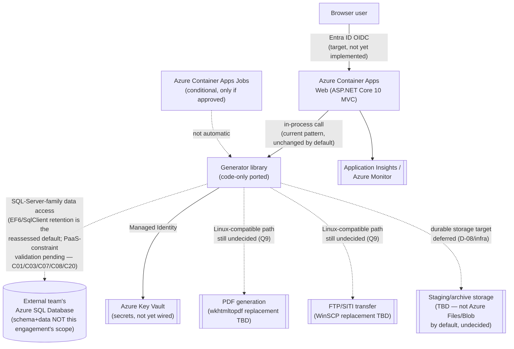

# Migration Plan — RPA Claim Statements (Claim Statement Generator / CSG)

> Produced by: Architect (Phase 1 — code-only execution pass)
> Date: 2026-10-16
> Status: **Draft for code-only execution; external contract/native-dependency choices required** — **not** Architect-production-approved, **not** a deployment-readiness sign-off
> Discovery Dossier: [reports/Discovery-Dossier.md](Discovery-Dossier.md)
> Capability Matrix: [reports/Capability-Matrix.yaml](Capability-Matrix.yaml)
> Application Assessment Report: [reports/Application-Assessment-Report.md](Application-Assessment-Report.md)
> Decisions Required: [reports/Decisions-Required.md](Decisions-Required.md) · Decision Log: [reports/Decision-Log.md](Decision-Log.md)

> **Scope lock:** This plan covers **code-only modernization**. The target Azure SQL Database **schema and data**
> are owned and supplied by an external team — no schema provisioning, schema/data conversion, or data movement is
> planned or performed by this engagement. Infrastructure provisioning, deployment, CI/CD execution, and
> post-migration ops (Phase 3–6) are **out of scope for this pass** and remain deferred pending the
> region/budget/DR/cutover/downtime decisions below — this is an explicit, user-confirmed scope boundary, not a
> blanket execution-gate waiver.
>
> **Supersession note (2026-10-16, same day — CURRENT, authoritative):** the user's D-04 selection was reversed
> from **Azure PostgreSQL** to **Azure SQL Database** (*"It will be Azure SQL Database, not postgresql"*) after this
> plan's original authoring pass. This plan has been reconciled in place to reflect Azure SQL Database as the
> current, authoritative target — see `reports/Decisions-Required.md` D-04 and `reports/Decision-Log.md` for the
> full decision history. **The scope itself is unchanged** — code-only modernization, external schema/data
> ownership — only the database engine selection changed. Historical PostgreSQL-specific content below that is not
> explicitly marked superseded has been updated in place; no prior dated Decision-Log entries were rewritten.

## 1. Executive Summary

Code-only modernization of a .NET 10 ASP.NET Core MVC app (already current runtime) whose Generator component is
deeply coupled to SQL Server (EF6, `SqlBulkCopy`, runtime-applied EF6 migrations, a stored-procedure-based role
store) and to Windows-native dependencies (`System.Drawing.Common`, WinSCP-wrapped FTP, `wkhtmltopdf.exe`). Target is
Azure Container Apps with a user-selected **Azure SQL Database** (superseded 2026-10-16 from an earlier Azure
PostgreSQL selection) whose schema/data an external team will supply; identity moves to Entra ID. **Because the
target is now the same SQL Server engine family as the source, the headline data-layer risk has narrowed:** EF6,
`System.Data.SqlClient`, T-SQL syntax, and `SqlBulkCopy` are the reassessed **default to retain**, not an ORM/engine
adapter decision to be made from scratch. The remaining headline risks are specific Azure SQL Database PaaS
constraints — no `xp_cmdshell`/host-level export (the current FDMR export pattern has no equivalent), no
cross-database queries (relevant to the separate Security database), no Windows-integrated authentication (requires
SQL auth or an Entra ID/managed-identity token-based design), and an explicit schema-ownership contract for the
runtime-applied EF6 migrations — each of which requires an explicit validation step before any Phase 2 code change
proceeds. Region/budget/DR/cutover/downtime remain deferred; Phase 3–6 are not scheduled by this plan.

**Verified baseline blocker:** On Windows x64 with SDK 10.0.401 / MSBuild 18.9.11, the no-restore build, restore, and build retry failed because the configured feed rejected `System.Management.Automation.dll` 10.0.10586 with HTTP 400/403. Both build attempts reported zero warnings and five errors. No successful compilation or test run was established; package/feed-owner approval is required for a remedy, not a policy bypass. See the [assessment](Application-Assessment-Report.md) for build evidence.

## 2. Approved Strategy

| Field | Value |
|-------|-------|
| Strategy | **refactor** |
| Discovery recommendation matched? | Yes — `Capability-Matrix.yaml#migration_strategy.recommendation: refactor` (labeled `⚠ Default guess`, still provisional pending Q1/Q2/Q4/Q9/Q12) |
| Refinement (if any) | None beyond the user's explicit code-only / external-schema-ownership scope clarification recorded in `reports/Decision-Log.md` (2026-10-16 reconciliation entries); the 2026-10-16 same-day D-04 engine supersession (PostgreSQL → Azure SQL Database) does not change the strategy or scope, only the engine selection. |

## 3. Target Azure Architecture

> **Conditional, not deployment-approved.** Only D-06 (hosting), D-09/D-10 (identity/tenancy), D-11 (compliance),
> D-16/D-17/D-18 (CI/CD, observability, registry) and D-04 (engine — Azure SQL Database, superseded 2026-10-16 from
> Azure PostgreSQL) are decided; D-07/D-08/D-12/D-13/D-14/D-15 remain pending. No region, SKU, network topology, or
> cost figure is invented below.

| Layer | Service | Why |
|-------|---------|-----|
| Compute (primary) | Azure Container Apps | D-06 ✅ DECIDED; conditional on resolving native-dependency and concurrency findings (Application-Assessment-Report R4, R7) |
| Compute (secondary, conditional) | Azure Container Apps Jobs | Only if an independently packaged batch path is explicitly approved — **not** automatic worker decomposition (`Capability-Matrix.yaml#migration_strategy.target_azure_candidates`) |
| Data | **Externally owned** — Azure SQL Database (exact SKU/tier/region/DR not this engagement's decision; superseded 2026-10-16 from an earlier Azure-managed PostgreSQL selection) | D-04 ✅ DECIDED (engine only, clarified — Azure SQL Database, NOT Managed Instance); D-05 🚫 N/A — no DB migration tooling/schema/data work in this engagement's scope |
| Identity | Microsoft Entra ID, single-tenant | D-09, D-10 ✅ DECIDED; code not yet changed (Application-Assessment-Report R11, Backlog C17) |
| Secrets | Key Vault with RBAC | Mandatory per agent guardrails; not yet wired (current state uses `App.config`/`ConfigurationManager`) |
| Network | Unknown / deferred | D-08 ⏸ PENDING; `Capability-Matrix.yaml#network.private_endpoints_needed: unknown` |
| Observability | Azure Monitor + Application Insights | D-17 ✅ DECIDED |
| Container registry | Azure Container Registry | D-18 ✅ DECIDED |
| Cost guardrails | Unknown / deferred | D-12 ⏸ PENDING — no monthly figures fabricated (see Application-Assessment-Report § Cost Note) |

### Architecture Diagram (conceptual target — not an approved deployment architecture)

> Dashed arrows mark paths with an unresolved decision or external dependency. No Front Door, Redis, or specific
> region/SKU is shown — none has been approved. **Diagram updated 2026-10-16** to replace the superseded
> Azure-managed-PostgreSQL node with the current, authoritative Azure SQL Database node (D-04 supersession).

## 4. Per-Phase Execution Plan

| Phase | Lead | Parallel | Skills to load | Inputs | Outputs | Quality gate | Effort |
|-------|------|----------|----------------|--------|---------|--------------|--------|
| **Phase 1 — Plan & Assess** | Architect | Azure Specialist, Database Specialist | `migration-artifacts/capability-matrix`, `migration-report-template`, `source-on-premise`, `stack-dotnet`, `stack-nodejs`, `workload-webapp`, `workload-batch-job`, `risk-low-evidence-confidence` | Discovery Dossier, Capability Matrix | `Application-Assessment-Report.md` (this pass), `Migration-Plan.md` (this file) | This plan is complete per § Quality Gates below; **no infra/deploy gate is waived** | **Done (this pass)** |
| **Phase 2 — Migrate Code** | Coder | Database Specialist (schema-ownership/auth-mode validation), Security Auditor (identity) | `stack-dotnet`, `dotnet-modernization`, `wcf-to-rest-migration` (not applicable — no WCF here), `config-transformation`, `azure-security-baseline/managed-identity` | This Migration-Plan, external Azure SQL Database schema/data/authentication contract (not yet received) | `Migration-Change-Log.md`; validated schema-ownership/auth-mode contract; retained (or, if separately approved, ported) data-access layer; Entra ID wiring | **First action: validate external contracts and native-dependency proofs — not implementation** (see § 10) | M–L (conditional, see Application-Assessment-Report backlog C01–C20; reduced from an earlier L–XL PostgreSQL-target estimate since EF6/SqlClient retention is now the reassessed default) |
| **DB Migration** | *Not applicable — external team owns schema/data* | — | — | — | — | D-05 🚫 N/A under current code-only scope; this engagement produces no `Database-Migration-Report.md` | **Out of scope** |
| **Phase 3 — Generate Infra** | Azure Specialist | DevOps Engineer, Security Auditor | `azure-infrastructure`, `azure-containerization` | Phase 2 output, resolved D-07/D-08 | `Infra-Plan.md`, IaC files | D-07 (IaC tool) and D-08 (region/residency) must move from ⏸ PENDING to ✅ DECIDED first | **Deferred — not scheduled by this plan** |
| **Phase 4 — Deploy to Azure** | DevOps Engineer | Cutover Commander, Tester | `azd-configuration`, `azure-X` | Phase 3 output | Deployment evidence | D-12/D-13/D-14/D-15 (cost, DR, cutover, downtime) must move from ⏸ PENDING to ✅ DECIDED first | **Deferred — not scheduled by this plan** |
| **Phase 5 — Setup CI/CD** | DevOps Engineer | Tester, Security Auditor | `github-actions-cicd` or `azure-devops-pipelines` (keep existing CI/CD per D-16) | Phase 4 success | Pipeline files | Not reached in this pass | **Deferred — out of scope for this pass** |
| **Phase 6 — Post-Migration Ops** | Observability Engineer | Performance Engineer, Cost Engineer | `azure-monitor-appinsights` | Deployment + pipeline | Operational runbook | **Phase 6 infra/ops execution is out of scope for this pass**; Application Insights/Azure Monitor **code-level instrumentation hooks** (D-17) may be added as part of Phase 2 code work, ahead of live ops wiring | Code instrumentation: **in current selected scope**; live ops: **deferred** |

## 5. Cross-Phase Risks & Mitigations

| Risk | Affected phases | Mitigation | Owner |
|------|-----------------|------------|-------|
| EF6 + `System.Data.SqlClient` + `SqlBulkCopy` + runtime-applied EF6 migrations retention against Azure SQL Database is the reassessed default, but specific Azure SQL Database PaaS constraints remain unvalidated (Application-Assessment-Report R1–R3; superseded 2026-10-16 from an earlier PostgreSQL-target assessment) | Phase 2 | No ORM/provider decision is required by the engine change alone; validate authentication-mode compatibility (SQL auth/Entra ID token-based access), confirm schema-ownership contract for runtime migrations, and confirm the FDMR `xp_cmdshell`/`bcp` export is redesigned as a client-driven process before any data-layer code change | Database Specialist, Coder |
| Windows-native dependencies (`System.Drawing.Common`, WinSCP/FTP, `wkhtmltopdf.exe`) block Linux Container Apps as-is (R4) | Phase 2, Phase 3 | Resolve Q9 (lowest-disruption Linux-compatible options); prove PDF-parity before container build | Coder, Azure Specialist |
| Custom SQL-Server role-store must be reconciled with Entra ID, and the separate Security-database connection may require cross-database query capability Azure SQL Database does not support (R5, R11) | Phase 2 | Resolve Q3 (role-mapping/delegation) and confirm the Security-DB topology/cross-database access pattern before implementing `Microsoft.Identity.Web` wiring | Security Auditor, Coder |
| Single-replica machine-scoped `Mutex` cannot coordinate across Container Apps replicas (R7) | Phase 2, Phase 3 | Decide single-replica constraint vs. distributed-lock rewrite before any multi-replica deployment is configured | Coder, Architect |
| External Azure SQL Database schema/data/authentication contract not yet received (superseded 2026-10-16 from an earlier external PostgreSQL schema/data contract need) | Phase 2 (blocking), DB (N/A) | Treat as a **prerequisite**, not a chat question — track as an open dependency until the external team delivers it | Database Specialist (liaison), Architect |
| Low evidence confidence across data/network/operational/compliance axes (R13) | All phases | Re-surface `low-evidence-confidence` explicitly at the start of each subsequent phase per `.github/skills/risk-low-evidence-confidence.md`; do not let later phases silently treat unverified facts as confirmed | Whichever role consumes the fact |

## 6. Quality Gates

### Standard gates (from `.github/copilot-instructions.md`)

These always apply. Referenced, not duplicated, here.

### App-specific extra gates (from Capability Matrix risk flags)

| Risk flag | Extra gate | Inserted before |
|-----------|-----------|-----------------|
| `low-evidence-confidence` | Re-check `.github/skills/risk-low-evidence-confidence.md` and the current state of Q1–Q12 | Before any Phase 2 code change that depends on a `low`-confidence Capability Matrix axis |
| (app-specific) native-Windows-dependency finding | Linux-compatibility + PDF/transfer-parity proof (golden-document comparison) | Before Phase 3 container image build |
| (app-specific) external-schema-dependency finding | External Azure SQL Database schema/data/authentication contract received and validated against the current EF6 model shape (superseded 2026-10-16 from an earlier PostgreSQL-contract requirement) | Before any Phase 2 data-access-layer code change (C01, C02, C04, C20) |
| (app-specific) single-replica-concurrency finding | Mutex/concurrency decision (C13) recorded | Before Phase 3 replica-count configuration |

## 7. Rollback Strategy Reference

> **Code-only scope: rollback here means source/release-artifact/config version rollback only.** No infrastructure
> teardown (`azd down`, `terraform destroy`) or database reset/destructive action is in scope, planned, or
> authorized by this plan — Phase 3/4 are not scheduled by this pass, and the target Azure SQL Database is
> externally owned (not this engagement's to reset).

| Phase | Rollback shape |
|-------|----------------|
| Phase 2 (code) | Git revert / redeploy the last known-good release artifact and configuration version; no destructive data action |
| DB | Not applicable — external team owns schema/data; this engagement performs no schema/data changes to roll back |
| Phase 3/4/5/6 | Not scheduled by this plan — no rollback shape defined here; will be addressed when those phases are explicitly resumed |

## 8. Status Tracking

| Artifact | Path |
|----------|------|
| Migration plan (this file) | `reports/Migration-Plan.md` |
| Application Assessment Report | `reports/Application-Assessment-Report.md` |
| Status dashboard | `reports/Report-Status.md` (owned by parent workstream) |
| Decisions log | `reports/Decision-Log.md` (owned by parent workstream) |
| Decisions required | `reports/Decisions-Required.md` (owned by parent workstream) |
| Capability Matrix | `reports/Capability-Matrix.yaml` (owned by parent workstream) |

## 9. Carried-Forward Assumptions

| # | Assumption | Impact if wrong | Owner to resolve |
|---|-----------|-----------------|------------------|
| A1 | The external team's Azure SQL Database schema will preserve the logical shape (entities, relationships, precision) the current EF6 model expects (superseded 2026-10-16 from an earlier PostgreSQL-schema assumption; identifier-casing risk specifically is retired, not carried forward, since Azure SQL Database shares SQL Server's casing/quoting conventions) | C01/C04/C20 data-layer work would need to be redone against a materially different shape | Database Specialist, by start of Phase 2 data-access work |
| A2 | Current source and tests are a useful modernization baseline, not proof of production equivalence (`Capability-Matrix.yaml#assumptions`) | Reconcile deployment drift before estimating or changing behavior | Coder / Architect, ongoing |
| A3 | Reported Azure connectivity can potentially support a transition, but connection type/reachability is unverified (Q5) | Network remediation or a different migration sequence may be needed | Azure Specialist, before Phase 3 (deferred) |
| A4 | Local DOCX/XSLT/font template assets can be obtained from an approved master source (Q8) | Reproducible packaging and PDF-parity acceptance remain blocked without this | Template/asset owner, before Phase 2 packaging work completes |
| A5 | A green baseline build can be established once the `System.Management.Automation.dll` 10.0.10586 feed-access issue is resolved externally | Phase 2 work cannot be validated by build/test until this is resolved; this plan does not claim Linux/PG readiness from any build attempt | Package-feed owner, before Phase 2 validation work begins |

## 10. Handoff to Migration-Orchestrator

**Next command:** `/phase2-migrate-code` (code-only execution)
**Lead:** Coder, with Database Specialist and Security Auditor in parallel
**First dispatch / first action:** **Validate the external Azure SQL Database schema/data/authentication contract and the Linux-native-dependency compatibility proofs (Q9) before any implementation begins** — Phase 2 does not start with code changes; it starts with contract and compatibility validation per the Application-Assessment-Report's backlog (C01, C02, C03, C04, C07, C08, C10–C12, C20). (Superseded 2026-10-16 from an earlier PostgreSQL-contract-focused first action — the validation-first sequencing is unchanged, only the specific contract items changed.)
**Watch list:** (1) the schema-ownership/migration-execution contract for runtime-applied EF6 migrations (C03) and the FDMR `xp_cmdshell`/`bcp` export redesign (C08) are now the largest blockers to Phase 2 data-layer work, replacing the earlier ORM/provider decision that applied to a PostgreSQL target; (2) the single-replica `Mutex` concurrency constraint (C13) must be resolved before any multi-replica Container Apps configuration is even drafted in a later phase.
**Explicitly not dispatched by this plan:** Phase 3 (Generate Infra), Phase 4 (Deploy), Phase 5 (CI/CD execution), Phase 6 (live post-migration ops) — these remain deferred pending D-07, D-08, D-12, D-13, D-14, D-15.

---
**Related reports:** [Discovery-Dossier.md](Discovery-Dossier.md) · [Capability-Matrix.yaml](Capability-Matrix.yaml) · [Application-Assessment-Report.md](Application-Assessment-Report.md) · [Decisions-Required.md](Decisions-Required.md) · [Decision-Log.md](Decision-Log.md) · [Report-Status.md](Report-Status.md)
